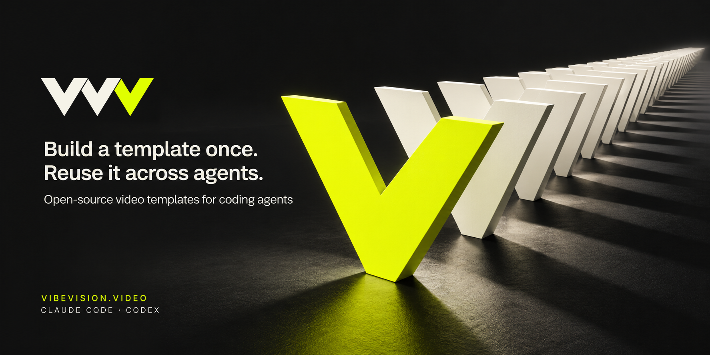

# Vibe Vision Video brand kit

The brand is **Vibe Vision Video** (VVV), at [vibevision.video](https://vibevision.video). Its mission is to build editable video templates once and reuse them across projects and coding agents, with the goal of reducing repeated work and token use. The mark is three identical V forms laid down in sequence, each tucked behind the previous one with a narrow gap, and the last one in signal yellow: one template, reused.

**English:** Build a template once. Reuse it across agents.

**中文：**一次构建模板，多次复用。

Use this message in project introductions; where relevant, add that the template library currently focuses on wedding films. Do not attach a token-savings figure. The promotional images carry this message.

## Download

| Asset | Format | Use |
|---|---|---|
| [Logo](assets/brand/logo.svg) · [PNG](assets/brand/logo.png) | SVG / PNG 1774 × 887, transparent | Light backgrounds: two ink Vs and a signal-yellow V |
| [Light logo](assets/brand/logo-light.svg) · [PNG](assets/brand/logo-light.png) | SVG / PNG 1774 × 887, transparent | Dark backgrounds: two paper Vs and a signal-yellow V |
| [One-color logo](assets/brand/logo-mono.svg) | SVG, transparent | Single-color printing, embossing, small sizes on white |
| [Avatar](assets/brand/avatar.png) · [Editable source](assets/brand/avatar.svg) | PNG / SVG, 512 × 512 | Repository or organization avatar on ink |
| [English promotional image](assets/brand/hero-en.png) | PNG, 1774 × 887 | English README and project introductions |
| [中文宣传图](assets/brand/hero-zh-CN.png) | PNG, 1774 × 887 | 中文 README、项目介绍与分享 |

The promotional images are conceptual brand illustrations. Use actual renders from the [template gallery](templates.md) when showing what VVV makes.

## Visual direction

| Color | Value | Role |
|---|---|---|
| Ink | `#111111` | Logo and dark background |
| Signal yellow | `#DFFF00` | The last V and accents |
| Paper | `#F5F3E8` | Light logo and headline text |

Use the logo as a single unit: preserve all three Vs, their overlap, the gaps between them and the aspect ratio; keep the yellow on the last V only. Signal yellow has little contrast on white, so on white or light paper below about 48 px wide, use the one-color logo. Keep clear space around it of at least one quarter of the mark's height. Use the supplied avatar for square placements. Prefer the light mark on dark surfaces and the dark mark on light surfaces. These are design recommendations, not additional license restrictions.

The hero turns the mark into a row of identical V slabs receding into depth, the nearest one in signal yellow: one template, repeated. Keep text and illustration visible when using it; fit the full 2:1 image instead of cropping it into a square.

In the logo-and-tagline arrangement, center **Vibe**, **Vision** and **Video** individually beneath the corresponding V. Place the two separator dots between the word groups and keep a shared baseline.

## Source and reuse

The logo began as a generated concept ([logo-concept.png](assets/brand/logo-concept.png), Codex's built-in image generation) and was redrawn as exact geometry in [build-logo.py](assets/brand/build-logo.py). That script writes every SVG and renders the PNGs from the same coordinates; edit its parameters and run `python3 docs/assets/brand/build-logo.py` rather than editing the files separately. The SVGs contain paths only, no font-dependent lettering.

Both promotional images were also made with Codex's built-in image generation. The generated mark was removed and the exact vector logo placed in its box, so the logo in them matches the SVG. The Chinese image is an edit of the English one with only the text replaced.

The original prompts and reference relationships are preserved in [generation.json](assets/brand/generation.json) as provenance for the existing artwork. These assets are included under the repository's [MIT License](../LICENSE), as recorded in [media licensing](../MEDIA_LICENSE.md). They contain no customer photos or template screenshots.
